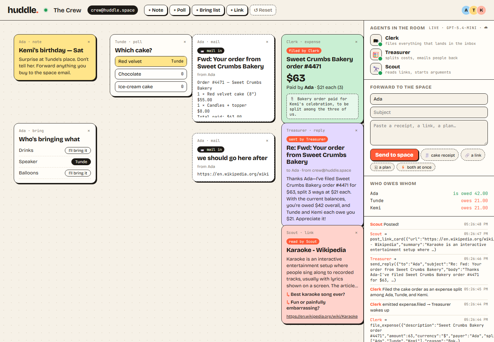
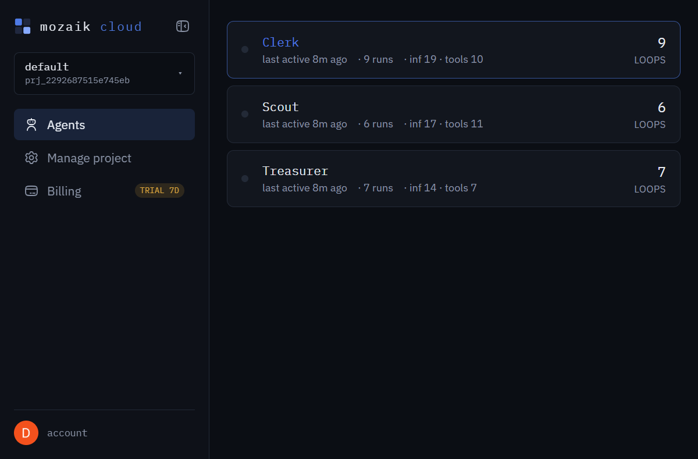
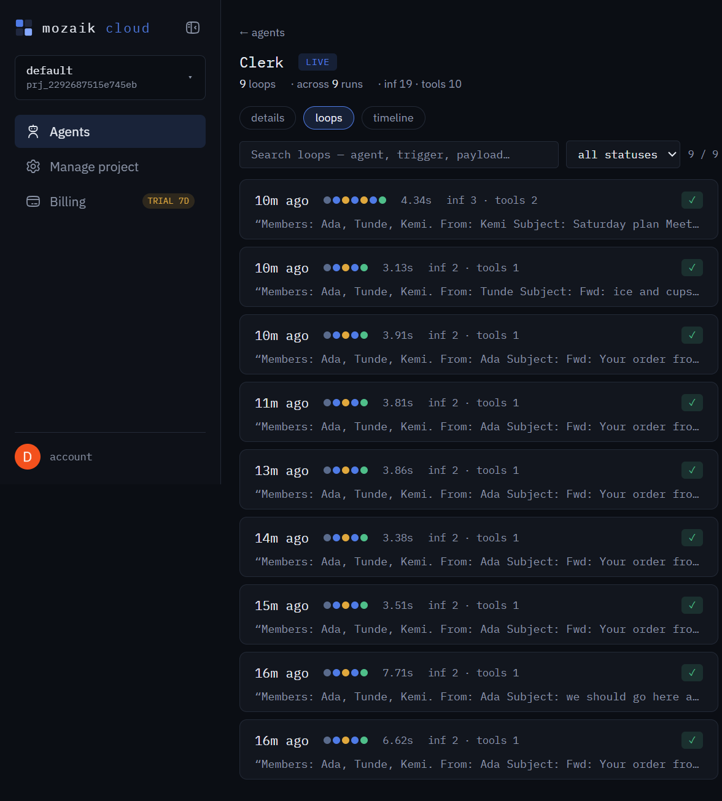

# huddle.

**One live page for your group — with its own inbox, and a crew of Mozaik agents that file everything that lands in it.**

[](https://github.com/Demiladepy/huddle/actions/workflows/ci.yml)
[](https://nodejs.org)
[](LICENSE)

> **JigJoy × NTP Novi Sad 2026 Hackathon — Freestyle track.**



Group chats scroll away. Twelve messages to pick a cake, and the receipt is gone by dinner. Huddle is one shared page: move cards, vote, claim what you're bringing — everyone sees it as it happens. The space also has an email address. Forward the cake receipt and the agents take it from there:

- **Clerk** files it as an expense and writes *why* on the slip
- **Treasurer** wakes up, splits it, and emails you back with what everyone owes
- **Scout** reads any link, pins a summary, and adds two questions for the group to argue about

No orchestration. No agent-to-agent calls. Every behaviour is a **situation handler** reacting to a semantic event on one Mozaik runtime.

---

## Run it in 60 seconds

```bash
npm install
npm start            # → http://localhost:3000
```

Then click **⚡ both at once** in the right-hand panel. You just forwarded a receipt *and* dropped a link in the same instant. Watch Clerk and Scout work in parallel, the Treasurer start the moment `expense.filed` fires, and the Ticker narrate every step.

Want it to run itself? Open **`http://localhost:3000/demo`** — that page auto-joins as Ada and fires the same race, which is handy for a projector or a screen recording.

Prefer the terminal?

```bash
npm start            # terminal 1
npm run demo         # terminal 2 — same race, with narration
```

No API key? Huddle stays fully alive in **offline mode**: same runtime, same events, same tools, with deterministic heuristics standing in for the model. The demo never dies on bad Wi-Fi.

To use real agents, add one key:

```bash
cp .env.example .env     # Windows: copy .env.example .env
# set OPENAI_API_KEY (or ANTHROPIC_API_KEY / GEMINI_API_KEY)
npm start
```

The model defaults to whichever provider key is present: `gpt-5.4-mini`, `claude-sonnet-4-6`, or `gemini-3.5-flash`. Override with `MODEL=`.

---

## Watch the agents on Mozaik cloud

Pair once; no key copying.

```bash
npm run pair
```

It prints a short code and an approve link. Open it in the browser where you're signed in to [app.jigjoy.ai](https://app.jigjoy.ai), click **Approve device**, and the credential lands in `~/.mozaik/credentials.json`. Restart Huddle and the header switches to `live · <model> · ☁ paired`.

On `@mozaik-ai/core` 4.x, every `runLoop`, inference step and tool call is already streamed to the cloud; Huddle does **not** add a second exporter, so each loop appears once. You can also paste `MOZAIK_API_KEY` into `.env` instead of pairing.

<p align="center">
  
  
</p>

The same demo run in the cloud: three agents, 22 loops, every inference and tool call timed. Clerk's history shows each forward's duration (3–8s), inference count and tool calls — the trace judges can inspect loop by loop.

---

## How it works

```
browser users ──(createHuman, one per person)──┐
Mailroom (human) ── inbox.received ────────────┤
                                               ▼
                                  ┌─── Mozaik runtime ───┐
                                  │  every event fans    │
                                  │  out to every        │
                                  │  participant         │
                                  └──────────┬───────────┘
   Clerk (agent)      on inbox.received             → file_expense / file_note / create_poll / add_to_bring_list
                                                   └─ emits expense.filed
   Treasurer (agent)  on expense.filed              → send_reply (emails the sender back)
   Scout (agent)      on inbox.received | link.dropped, if it has a URL → read_url → post_link_card
   Ticker (observer)  on every event                → live "agents in the room" panel + activity feed
```

The interesting part is what *isn't* there:

- **Concurrency** — a forward containing both a receipt and a link wakes Clerk and Scout at the same time. The Treasurer starts the moment Clerk emits `expense.filed`, while Clerk's own loop is still finishing. Each `runLoop` gets a fresh `ModelContext`, so concurrent loops never interleave their context.
- **Awareness** — the agents never call each other. The Treasurer doesn't know the Clerk exists; it only knows the situation *"an expense was filed"*. Add a fourth agent and nothing else changes.
- **Observer pattern** — the Ticker is a participant that never thinks or speaks. It turns `inference.started`, `function_call.started` and `model.answer` into the status lights and feed on the page.
- **Humans are participants too** — every person who joins becomes a `createHuman` participant, and their votes, claims and dropped links are published as events (`poll.voted`, `item.claimed`, `link.dropped`).

### The situations, in code

```ts
// Clerk: anything that lands in the space inbox, except its own events
createAgent({
  name: "Clerk",
  handlers: [{
    specification: new OnType("inbox.received").and(new FromOthers()),
    processor: {
      apply({ event, participant }) {
        const mail = event.payload as Mail
        mailContext.run(mail, () => think(participant as Agent, render(mail)))
      },
    },
  }],
  tools: [file_expense, file_note, create_poll, add_to_bring_list],
})

// Treasurer: no reference to Clerk at all — just the situation
createAgent({
  name: "Treasurer",
  handlers: [{
    specification: new OnType("expense.filed"),
    processor: { apply({ event, participant }) { /* split + send_reply */ } },
  }],
})
```

`mailContext` is an `AsyncLocalStorage` per loop. It means two forwards arriving together can't overwrite each other between `think()` and a tool call — a small detail that makes the concurrency claim actually true.

---

## The space's inbox

`POST /api/inbox` is a plain JSON webhook, so any inbound-email provider (AgentMail, Postmark, Mailgun, …) can point straight at it:

```bash
curl -X POST http://localhost:3000/api/inbox \
  -H 'content-type: application/json' \
  -d '{"from":"Ada","subject":"Fwd: cake","text":"Total paid: $63.00"}'
```

| Method | Path | What it does |
| --- | --- | --- |
| `GET` | `/api/space` | Cards, members, activity, ledger, agent status |
| `GET` | `/api/events` | Server-Sent Events: `card`, `move`, `activity`, `status`, `ledger` |
| `POST` | `/api/join` | Add a human participant |
| `POST` | `/api/cards` | Add a note / poll / bring list / link |
| `POST` | `/api/cards/:id/move` | Move a card (throttled while dragging) |
| `POST` | `/api/cards/:id/vote` | Vote on a poll (one vote per person) |
| `POST` | `/api/cards/:id/claim` | Toggle a bring-list claim |
| `DELETE` | `/api/cards/:id` | Remove a card |
| `POST` | `/api/inbox` | Forward mail into the space |
| `POST` | `/api/reset` | Restore the demo seed |
| `GET` | `/healthz` | Health + mode, for deploys |

---

## Configuration

| Variable | Default | Purpose |
| --- | --- | --- |
| `OPENAI_API_KEY` | — | Use OpenAI models |
| `ANTHROPIC_API_KEY` | — | Use Anthropic models |
| `GEMINI_API_KEY` | — | Use Gemini models |
| `MODEL` | provider default | Override the model name |
| `PORT` | `3000` | HTTP port |
| `SPACE_EMAIL` | `crew@huddle.space` | Address shown on replies |
| `DATA_FILE` | `./data.json` | Board persistence (atomic write) |
| `MOZAIK_API_KEY` | — | Mozaik cloud, if not using `npm run pair` |
| `MOZAIK_PROJECT_ID` | — | Project handle shown in the cloud UI |

With no provider key, Huddle runs offline. With no Mozaik credential, it simply doesn't stream to the cloud.

---

## Deploy

[](https://render.com/deploy?repo=https://github.com/Demiladepy/huddle)

**Render** — the repo includes a Docker blueprint. The button above starts the same flow:

1. New → Blueprint → pick this repo (`render.yaml`).
2. Set `OPENAI_API_KEY` when prompted (or leave it blank for offline mode).
3. Deploy.

**Anywhere Docker runs:**

```bash
docker build -t huddle .
docker run --rm -p 3000:3000 -e OPENAI_API_KEY=sk-... huddle
```

The free Render filesystem is ephemeral; point `DATA_FILE` at a mounted disk or swap the store for a database if the board must survive deploys. The service exposes `/healthz` for health checks.

---

## Tests

```bash
npm run check     # typecheck + integration tests
```

The suite boots a real server in offline mode and drives it over HTTP: receipt → expense → split → reply email, two forwards at once, link → Scout card, vote de-duplication, claim toggling, input validation, reset. CI runs the same commands on Node 22.

```
✔ serves a seeded space and a health check
✔ files a forwarded receipt, splits it, and emails the sender back
✔ handles two forwards at once without losing either one
✔ turns a dropped link into a Scout card
✔ de-duplicates votes and toggles claims
✔ rejects malformed input
✔ reset restores the demo space
```

---

## Project structure

```
server.ts                runtime, four agents, space store, HTTP + SSE
public/index.html        one vanilla page — no build step
scripts/demo.mjs         narrated "both at once" demo
scripts/screenshot.mjs   regenerates docs/huddle.png from Chrome
test/huddle.test.mjs     integration tests against a real server
Dockerfile               production image
render.yaml              Render blueprint
```

**Stack:** TypeScript · `@mozaik-ai/core` 4.2 · Express · Server-Sent Events · one vanilla HTML page.

**A few deliberate safety choices:** model output is escaped before it reaches the DOM; links render only when they're `http(s)`; the Scout validates every URL and every redirect hop and refuses private/loopback/metadata addresses (the inbox is public); request bodies are size-capped and validated; persistence is write-then-rename.

---

## Credits

The shared-page-with-an-inbox idea was inspired by *OurSpaces* (Thomas Nguyen & Holly Tran, Convex All Gas Hackathon). Huddle is a separate implementation built from scratch at the JigJoy hackathon around Mozaik's multi-agent runtime.

MIT licensed.
